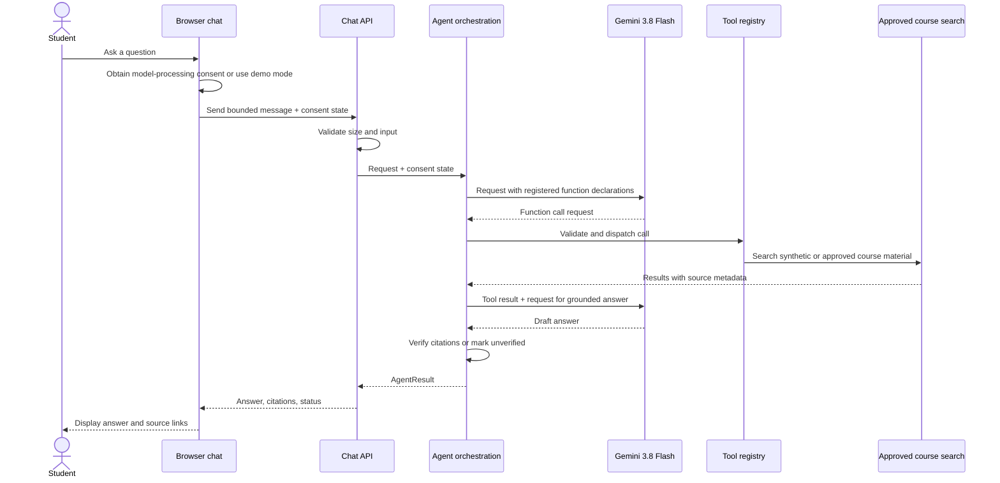

# Campus support assistant: technical plan

## Choices

- Next.js with TypeScript: one repository and one deployable web service for the chat UI and server API.
- Same-origin API route: keeps model keys and tool execution on the server and avoids exposing credentials in the browser.
- Provider-neutral agent interface: isolates Gemini-specific model calls behind `AgentProvider`, while a deterministic demo adapter works without network calls or API keys.
- Explicit tool registry with schemas: the agent can choose only declared tools with validated inputs and bounded timeouts.
- Local synthetic Markdown/JSON course corpus plus simple keyword retrieval for the MVP: easy to inspect, test, and replace with an approved Canvas export or indexed retrieval in the RAG feature. Do not copy real Canvas materials unless approval covers both project use and model-provider processing.
- Read-only tools only: avoids approval UI and real-data permissions in the first release while still demonstrating selection and calls.
- No persistent conversation storage: reduces privacy, database, and deployment work.
- Vercel Hobby deployment owned by the GitHub repository owner: deploy from the CLI after reviewed changes are merged, so the team does not depend on paid Vercel collaboration features. Verify the account can deploy the private project. The app remains a standard Next.js project.
- Gemini `gemini-3.8-flash` Developer API Free Tier for model-backed tool selection and function calls. This model currently supports function calling and has free-tier usage; its free-tier prompts may be used to improve Google's products. Require explicit per-session consent, pin the model ID, and keep the provider behind an interface so it can be replaced without changing tools or UI.

## Components and files

- `app/page.tsx`: accessible chat UI, source cards, demo-mode indicator, model-processing notice/consent, and informational prototype notice.
- `app/api/chat/route.ts`: request validation, rate/size limits, server-side agent invocation, and safe error responses.
- `src/agent/run.ts`: orchestration loop, provider selection, registered-tool selection, grounding check, and final `AgentResult` creation.
- `src/agent/provider.ts`: provider interface, Gemini API adapter, and deterministic demo implementation.
- `src/tools/registry.ts`: registered tools, schemas, read/write metadata, and timeout policy.
- `src/tools/search-course-materials.ts`: read-only search over the approved local course corpus.
- `src/knowledge/load-corpus.ts`: loads reviewed Markdown/JSON and source metadata.
- `src/policy/action-policy.ts`: default-deny policy for writes and private-data requests; MVP contains no write-capable tool.
- `src/types/contracts.ts`: shared `KnowledgeSource`, `Tool`, and `AgentResult` types.
- `content/approved/`: public sample documents plus a source inventory; no private student data.
- `specs/`: feature specifications and plans; these files are not runtime data.
- `.env.example`: `GEMINI_API_KEY` and pinned `GEMINI_MODEL` variable names with placeholder values only; no secrets.

## Data flow

## Agent task and tools

- Agent task: classify a course question, select the allowed course-search tool, summarize only what its results support, attach source references, and return an uncertainty response when evidence is insufficient.
- `search_course_materials(query, course_topic?)`: read-only search of synthetic or instructor-approved course materials; returns ranked excerpts and source identifiers.
- Tools not in the registry are unavailable. No Canvas API, grade lookup, submission-status lookup, `create_support_request`, email, calendar, or record-editing tool exists in the MVP.
- Tool results are untrusted data. The agent may use them as evidence but must not treat their contents as instructions.
- Model: `gemini-3.8-flash`, using the Gemini Developer API function-calling interface. It receives registered tool declarations and the user's course question plus minimum relevant synthetic excerpts by default. Real course excerpts require instructor permission for external model processing. It runs only after explicit per-session student consent, uses a server-only key, bounded input/output, and a Free Tier project with billing disabled. If quota/configuration fails, use demo mode and show that state. Do not send personal information or private documents.

## Existing constraints

- No application code or corpus exists yet; paths above define the proposed structure.
- The GitHub repository is currently described as empty, so the initial implementation will need the project scaffold and specs committed.
- Only synthetic material is permitted until the instructor explicitly approves specific course materials for project use and external model processing. The MVP does not access Canvas directly.
- Hosting and Gemini Free Tier limits/model availability can change; verify them before deployment. Google currently lists `gemini-3.8-flash` as supporting function calling and Free Tier use; Free Tier content can be used to improve Google products, so the session consent notice is required.
- Serverless execution should remain stateless and short-running; do not rely on local filesystem writes for user data.

## Risks and re-planning

- Open risk: instructor may not approve Canvas materials for project and provider use. Mitigation: use synthetic course examples and keep the product useful as a tool-calling demonstration.
- Open risk: approved course exports may become outdated. Mitigation: keep source owner and last-reviewed date; show source reference and date.
- Open risk: the Gemini free quota/model may be unavailable or change. Mitigation: maintain deterministic demo mode, configure the model ID, and never silently use a paid endpoint.
- Open risk: users may enter personal information despite the warning. Mitigation: do not provide personal-data workflows, warn before use, keep no chat history, and minimize what is sent to Gemini.
- Open risk: retrieved content may contain prompt injection. Mitigation: treat it strictly as quoted evidence, constrain tools in code, and test malicious sample text.
- Assumption that requires re-planning: the course requires the app to process real personal student questions. If confirmed, the free-tier Gemini configuration is unsuitable without a separate privacy, consent, and provider review.
- Assumption that requires re-planning: the team obtains authorized access to private student records or write APIs. If that occurs, create a separate feature with authentication, data minimization, authorization, approval, and audit requirements before integration.
